# Fil

A Chrome extension to reread your exported conversations, and to remember them. Messenger, WhatsApp, Telegram, Instagram and Discord exports go in; Fil gathers them by person, cuts years of messages into real conversations, gets each one summarised and tagged by the LLM of your choice, and lets you find anything again: by words, by mood, by period, by person, or by asking a question in plain language, in any language. On top of that it writes one page per month of your life, across every conversation.

It was made for long conversations written in Algerian darja, French and English, all mixed together, by someone who keeps forgetting what was said.

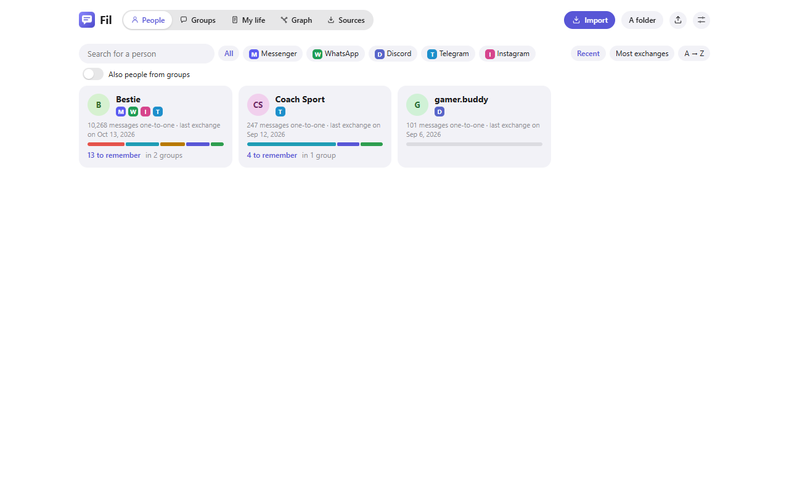

## People, groups and platforms

- **One home screen for everyone.** A card per person: the platforms you talk on, how many messages you exchanged, when you last wrote, a bar of the moods of your conversations, the things still to remember, and the groups you share. Search by name, filter by platform, sort by recent, volume or name. Groups have their own tab.
- **One person, several platforms.** When the same name shows up on two platforms (Bestie on Messenger and on WhatsApp), Fil suggests linking them; one click puts all their conversations on the same page. You can link anyone by hand, rename a person, or detach a name. Nothing is merged inside the messages.
- **Groups.** Group conversations show who wrote each message, the LLM is told who said what, the analysis has one card per member, and the portrait describes the group. The page of a person lists the groups you share with them and how much they write there.
- **The page of a person.** Their moods and topics, your conversations on each platform, the groups in common, what is left to remember, and the other conversations where they are mentioned. A back button brings you there from a conversation.

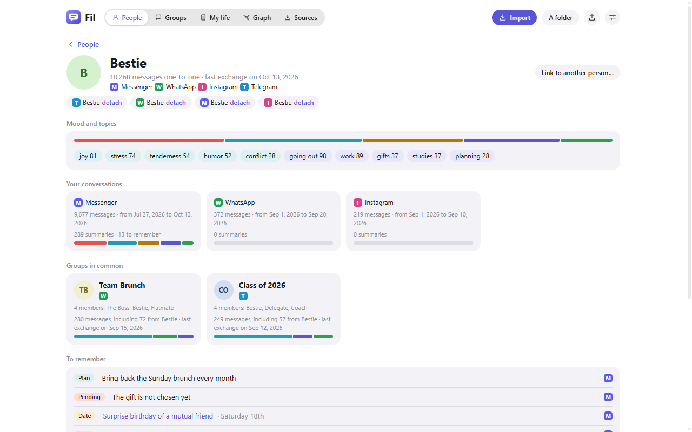

- **Platforms.** Fil recognises the export by itself and asks only what the file does not say: which name is yours (once per platform, then it remembers), or whether a Meta file comes from Messenger or Instagram when its folder does not say.

| Platform | What to import | Notes |
| --- | --- | --- |
| Messenger | The JSON of end-to-end encrypted chats, or the folder of "Download your information" | Photos and videos are not in encrypted exports |
| WhatsApp | The `.txt` of "Export chat", or the `.zip` as it comes | One chat at a time |
| Telegram | `result.json` from Telegram Desktop | Secret chats are never exported |
| Instagram | The `messages` folder of "Download your information" (or its `.zip`) | Broken accents of those files are repaired |
| Discord | The data package, folder or `.zip` | Discord gives only your own messages |
| Snapchat, SMS, Signal, iMessage | — | Listed as coming, or without an official export |

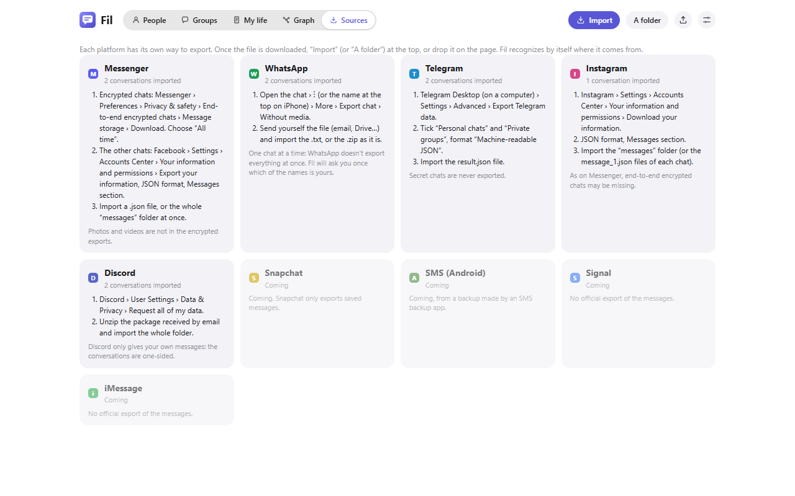

- **The graph.** You in the middle, the people you talk with, the groups they are in, and the people and places mentioned in your conversations, tied to where they are mentioned. Hover a point to see its links, click to open it, zoom and move around.

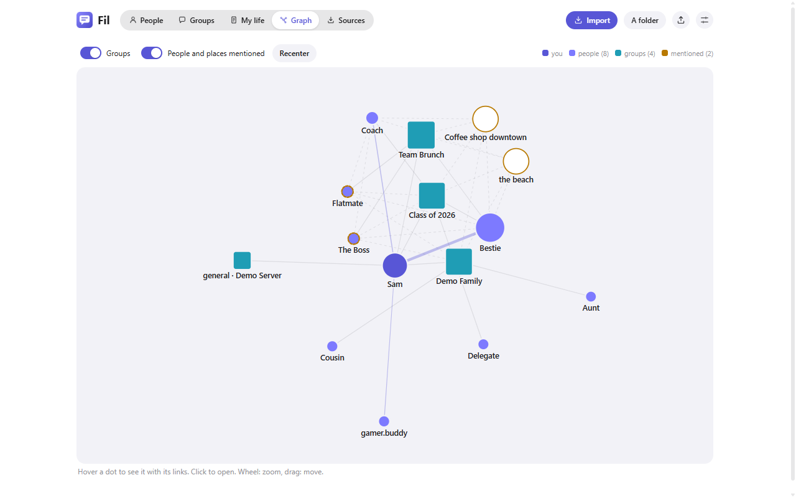

- **My life.** One page per month across every conversation, written by the LLM from the chapters and summaries already made (never from the messages): what happened, what changed in your relationships, with whom. Each month links to the conversations it comes from.

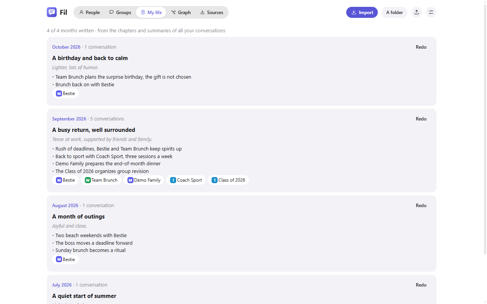

## Inside a conversation

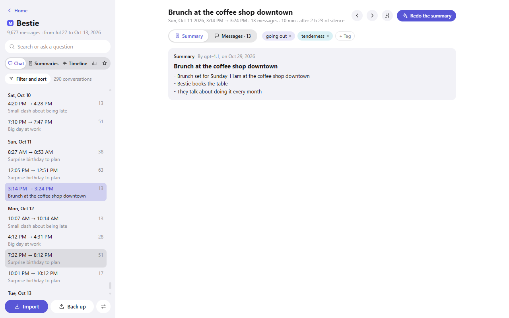

- **Conversations, not days.** A conversation ends after a silence (1 hour by default, or 30 min, 2 h, 3 h). One that goes from 23:00 to 00:30 stays in one piece. You can merge two conversations, or cut one with the scissors that show up when you hover a message. An LLM can also settle the doubtful silences, the ones close to the limit, by reading the messages around them. Your corrections always win over the LLM's.
- **Summary or messages.** Each conversation opens on its summary (a title, the points worth remembering, tags), with its messages one click away.
- **Summaries and tags from your LLM.** Any OpenAI-compatible service works: OpenAI, LiteLLM, OpenRouter, Ollama… One conversation at a time, or a whole period in one go. Summaries are saved: nothing is ever sent twice unless you ask to redo it. Tags come in two families, topics and moods. The LLM must reuse the existing list, and you can rename, merge or delete tags without calling the LLM again.
- **Changing the cut loses nothing.** Every summary is kept for the cut it was made with. When a longer conversation contains several summarised ones, it shows them end to end without asking the LLM.
- **Search that knows darja written in Latin letters.** `khdma` finds `khedma`, `3lach` finds `alach`. Search also looks in titles, tags and summaries, so a French word finds a conversation that was written in darja. You can type several words (in any order), `"an exact phrase"`, or `-word` to leave some out. Results are grouped by conversation and ranked, with the messages before and after each hit.
- **Ask a question.** "When did we plan the brunch?": the LLM answers from your summaries and links to the conversations it used. Answers are kept, so asking again costs nothing.

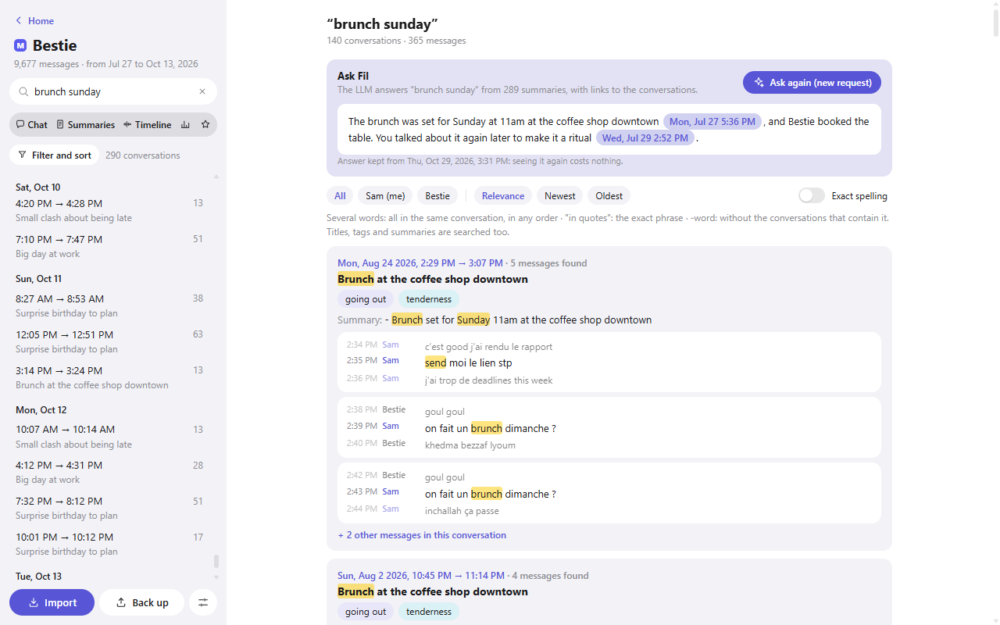

- **Timeline.** Every conversation is a bar, as wide as it lasted; the periods you have not imported yet are hatched. Zoom with the mouse wheel and move along with Shift + wheel. Drag across it to pick a period, then summarise it, filter on it or zoom on it. A band under the bars shows the moods week by week.

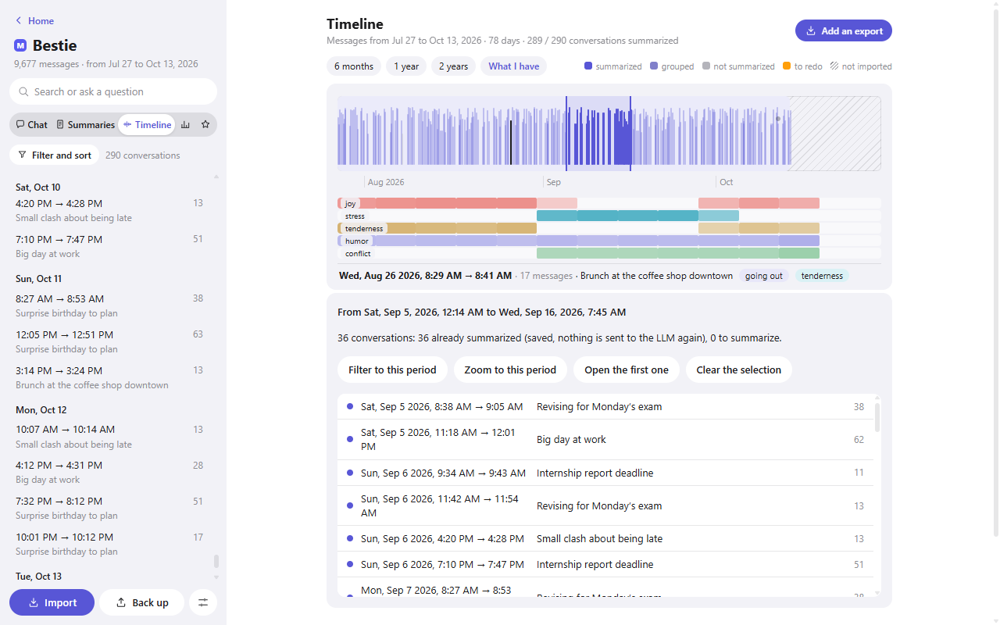

- **Filters and sorting.** By period (with a calendar), tags, status, size. Sort by date, length, number of messages, silence before, or favourites. The filters apply everywhere at once.
- **Chapters.** A summary of the summaries for each week and each month, to reread a whole month in a minute.
- **To remember.** Promises, plans, dates, open questions and facts, picked from the summaries month by month, each with a link to its conversation and a box to tick when it is done.
- **People and places.** Who is who, and in which conversations.

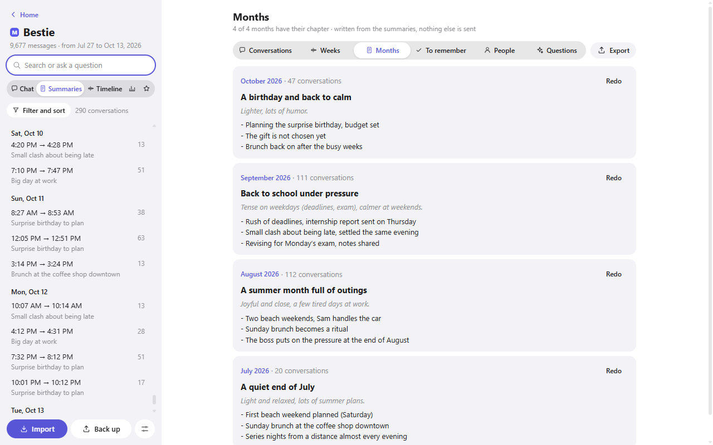

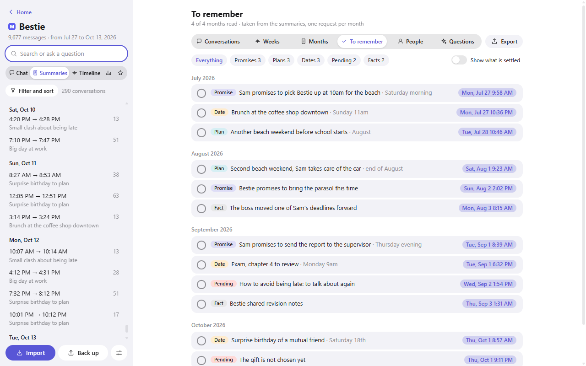

- **Analysis.** Figures for each person (share of messages, words per message, reply time, who starts conversations, questions, messages at night, emojis), the languages each one uses, when you write (day × hour), messages per week, and moods month by month. Everything is worked out on your computer.
- **Portrait.** A description of how each person writes and reacts, and of how the exchange works between you, written by the LLM from the summaries, the figures and 40 messages of each person. It describes habits only: the instructions forbid diagnoses, psychological labels and judgements, and every point must point to the conversations it comes from.

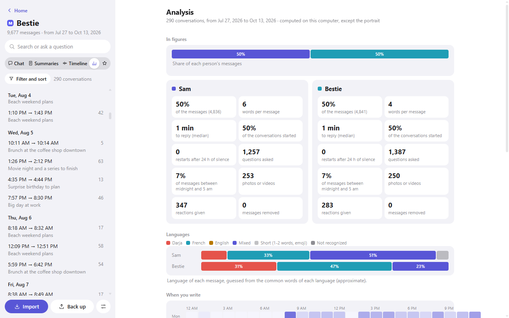

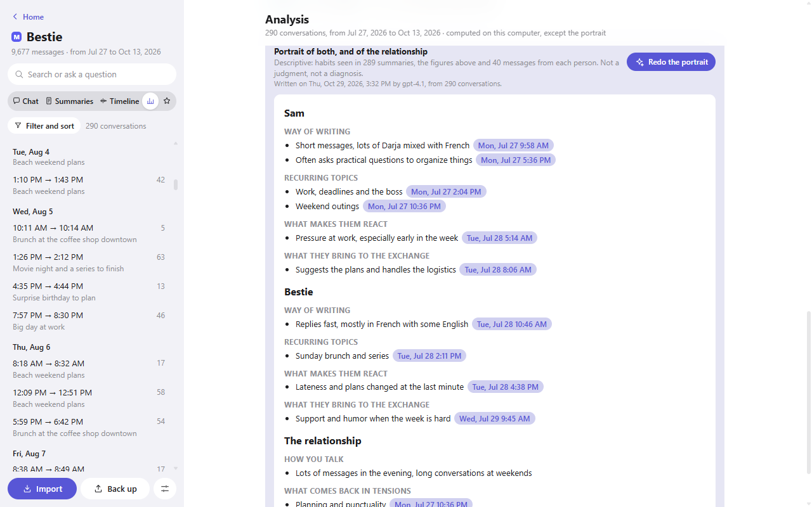

- **Later exports fill the gaps.** Importing a newer or longer export shows first what it would add on the timeline. Messages that are already there are never overwritten; only the missing periods are added.
- **Export.** Months, weeks, conversations, things to remember, people and places, as a Word file or as a PDF.
- **Backup.** One file with everything (every conversation with its messages, people and links, summaries, tags, chapters, ticks, My life), to put back after reinstalling. It never contains your LLM key.

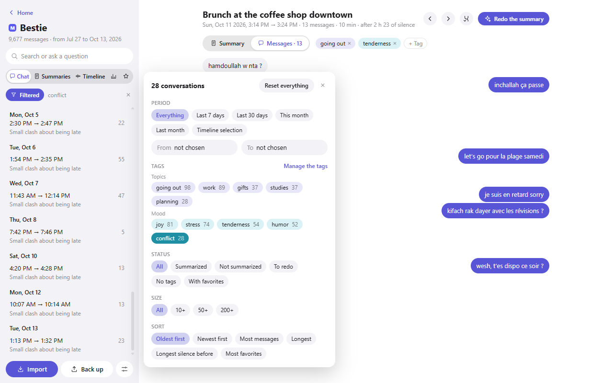

The interface follows the language of Chrome: English by default, French when Chrome is set to French. The summaries, chapters and portraits are written in that language too. The conversations and people in the screenshots are made up for the demonstration.

## Install

The extension is not on the Chrome Web Store, so it is loaded by hand:

1. Download this repository (**Code**, then **Download ZIP**) and unzip it, or clone it.
2. Open `chrome://extensions` and turn on **Developer mode**.
3. Click **Load unpacked** and choose the folder.
4. Click the Fil icon in the toolbar: it opens on the home screen.

## Getting your conversations

The **Sources** tab explains, platform by platform, where the export is. For Messenger, conversations that are end-to-end encrypted are not in Facebook's usual "Download your information": in Messenger, **Preferences › Privacy and safety › End-to-end encrypted chats › Message storage › Download secure storage data**, and choose **All time**. Import one file, several, a whole folder (**A folder**), a `.zip`, or drop them on the page.

Importing a newer export of a conversation you already have only adds what is missing.

## Connecting an LLM

Open the settings (the sliders button, top right on the home screen) and give the address of an OpenAI-compatible API (ending in `/v1` or in `/chat/completions`), the model and the key. Chrome then asks to let Fil reach that one site, and nothing else. **Save and test** sends a one-word request to check it works.

Without an LLM, Fil still reads, cuts, searches and counts, and each conversation has a button to copy it with summary instructions, to paste into any chat assistant.

## What it cannot do

- **Photos, videos and voice messages.** They are not in the export.
- **One thread for a person across platforms.** A person's conversations are gathered on their page, but each platform's conversation is read on its own.
- **Snapchat, SMS, Signal, iMessage.** Not read yet; Signal and iMessage have no official export.
- **Read the export straight from Messenger.** You download it, then import it.
- **Guarantee the LLM's work.** Summaries, tags, chapters, portraits and answers are written by a model and can be wrong or miss things. Every one of them links back to the messages so you can check.
- **Recognise every language perfectly.** The language figures are guessed from common words; short messages ("ok", "hhh", an emoji) are counted apart.

## Privacy

Everything stays in the extension's own storage on your computer, including the conversations of other people you imported. Fil has no server and makes no request on its own. The only requests are the ones you trigger, to the LLM you configured: the messages of the conversations you ask to summarise, tag or check, the summaries for chapters, questions, My life and the portrait, and 40 messages of each person for the portrait. Nothing else leaves your computer.

The LLM key is kept in the extension's storage, not encrypted, and is never put in backups. Uninstalling the extension deletes everything it stored: keep a backup.

| Permission | Why it is needed |
| --- | --- |
| Access to the site of your LLM (asked when you save the settings) | Send the requests you trigger to the service you chose. Fil asks for that one site only |

## License

[MIT](LICENSE) © 2026 Yanis Arris
